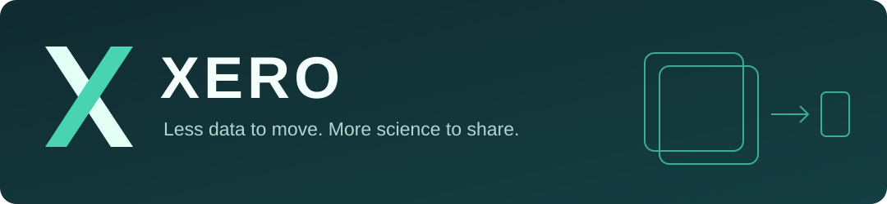

<div align="center">



**Cross-platform Error-bounded Representation of Optical microscopy images**

[](LICENSE)
[](docs/installation.md)
[](https://xero-viewer.pages.dev/project/)
[](https://xero-viewer.pages.dev/xero/)
[](imagej/README.md)
[](napari/README.md)

</div>

XERO compresses microscopy movies and image stacks with a **pixelwise relative-error bound**. It writes OME-Zarr images that can be decoded on demand, without saving a fully decompressed copy.

## Start with the viewer

| Interface | Get started |
|---|---|
| Browser | [Open the viewer](https://xero-viewer.pages.dev/xero/) — no installation |
| ImageJ / Fiji | [Download and install the plugin](imagej/README.md) |
| napari | [Install the XERO reader](napari/README.md) — instructions for existing and new napari users |
| Python | [Read frames and ROIs from OME-Zarr](docs/python.md) |

[Download example recordings](imagej/examples/README.md) · [Download other datasets or frame ranges](docs/download.md)

## Quick start

Training and CLI compression require **Linux, an NVIDIA GPU and the CUDA toolchain**. Follow the [installation guide](docs/installation.md), then [train a model](docs/training.md) or try the [short round-trip tutorial](tutorials/README.md).

Compress a single-channel `[frames, y, x]` sequence using a trained checkpoint:

```bash
xero encode --input denoised.h5 --checkpoint outputs/model/latest.pt \
  --output outputs/movie.ome.zarr --axis t
xero decode --archive outputs/movie.ome.zarr --output outputs/reconstructed.tif
xero verify --archive outputs/movie.ome.zarr --input denoised.h5
```

Use `--axis t` for time series or `--axis z` for structural stacks. Supported inputs are `float32`, `uint16` or `uint8` arrays in HDF5 (`data`), NumPy or memory-mappable TIFF. The checkpoint determines the error bound.

## Error guarantee

For every finite input pixel, encoding independently verifies:

```text
abs(decoded - input) <= epsilon * abs(input)
```

Zero is reconstructed exactly. For denoised input, the bound covers compression error, not denoising error.

[Method](docs/method.md) · [OME-Zarr format](docs/ome-zarr.md) · [Validation](docs/validation.md) · [Tutorials](tutorials/README.md)

## License and support

Source code: [MIT](LICENSE). Bundled dependencies have [separate licenses](imagej/THIRD_PARTY_NOTICES.md); datasets retain their providers' usage conditions.

[Report a problem](https://github.com/NICALab/XERO/issues) with your OS, GPU/driver, software versions and error message.
